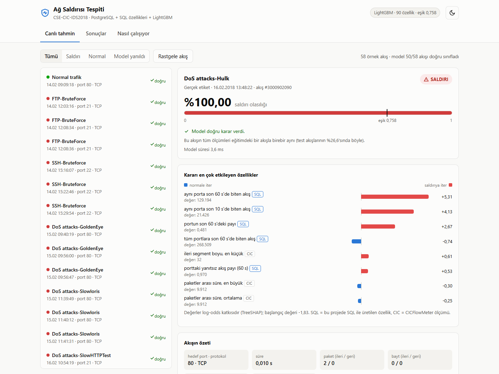
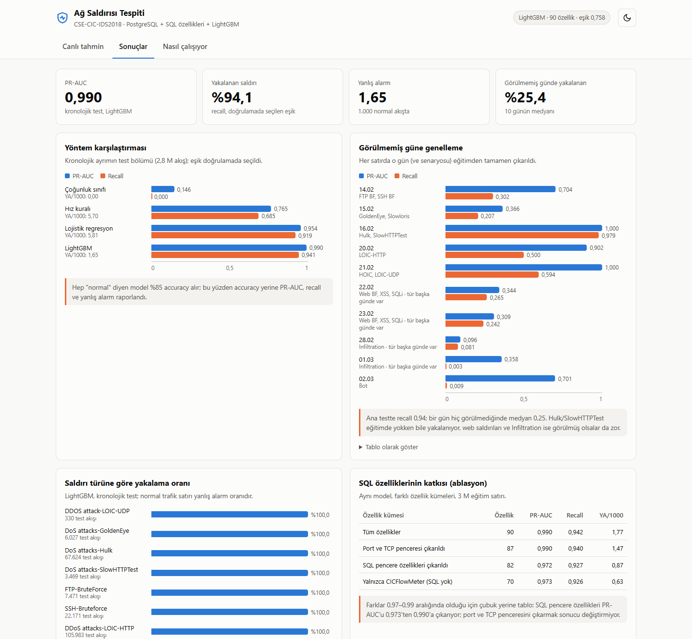
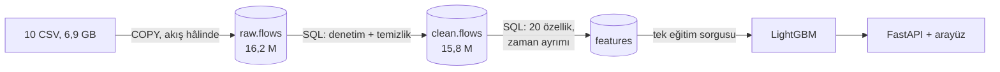

# Ağ Saldırısı Tespiti: PostgreSQL + SQL özellikleri + LightGBM

CSE-CIC-IDS2018 veri setindeki **16,2 milyon ağ akışını** PostgreSQL'e yükleyip temizleyen,
model özelliklerini **SQL ile** üreten ve her akış için "saldırı mı, normal mi" kararı veren sistem.
Bir web arayüzüyle birlikte gelir: gerçek test akışlarını seçip modelin kararını ve **neden** o kararı
verdiğini görebilirsiniz.



*Bir DoS-Hulk akışı: tek başına sıradan görünen bir bağlantı (2 paket, 0 bayt). Kararı, SQL'de
hesaplanan "aynı porta son 60 saniyede 129.194 akış bitti" özelliği veriyor.*

## Sonuçlar

| Test | PR-AUC | Yakalanan saldırı | 1.000 normal akışta yanlış alarm |
|---|---|---|---|
| Aynı saldırının ileriki dakikaları (kronolojik test, 2,8 M akış) | **0,990** | **%94,1** | **1,65** |
| Hiç görülmemiş bir gün ve saldırı senaryosu (10 günün medyanı) | 0,53 | %25,4 | 0,21 |
| Karşılaştırma: tek kurallı eşik ("porta 60 s'de ≥ 9.357 akış") | 0,765 | %68,5 | 5,70 |

Model tanıdığı saldırıları çok iyi yakalıyor, ama **hiç görmediği bir senaryoya genellemesi zayıf**.
Hacim bırakan saldırılar (DoS, DDoS, kaba kuvvet) neredeyse tamamen yakalanıyor; web saldırıları
(XSS, SQL Injection) ve Infiltration akış istatistiklerinden zor ayrılıyor. Veri laboratuvarda
üretildi, bu sayılar gerçek bir ağdaki performansı göstermez.



Tüm tablolar, deney tasarımı ve sızıntı denetimleri: **[docs/YONTEM.md](docs/YONTEM.md)**.

## Hızlı başlangıç (veritabanı gerekmez)

Eğitilmiş model ve test bölümünden 58 örnek akış repoda. Arayüzü açmak için:

```bash
python -m venv .venv
```

```bash
.venv/bin/pip install -r requirements.lock
```

```bash
.venv/bin/python -m ids serve
```

Ardından <http://127.0.0.1:8000> adresini açın. (Windows'ta `.venv/bin/` yerine `.venv\Scripts\`.)

Arayüzde üç sekme var:
- **Canlı tahmin:** Bir akış seçince saldırı olasılığını, eşiği, kararın doğru olup olmadığını ve
  kararı en çok etkileyen özellikleri görürsünüz. İsteği düzenleyip yeniden gönderebilirsiniz;
  geçersiz girdiyi API reddeder.
- **Sonuçlar:** Yöntem karşılaştırması, görülmemiş güne genelleme, saldırı türüne göre yakalama oranı,
  ablasyon.
- **Nasıl çalışıyor:** Veri hattının adımları ve sayıları.

API doğrudan da kullanılabilir: `POST /predict`, `POST /explain`, `GET /model`, `GET /examples`,
`GET /results`. Etkileşimli belge: <http://127.0.0.1:8000/docs>.

## Nasıl çalışıyor



1. **İçe aktarma.** CSV'ler satır satır okunup `COPY` ile güne göre bölümlenmiş tabloya yazılır.
2. **Temizlik (SQL).** Saat damgalarındaki 12 saat hatası düzeltilir (AM/PM bilgisi yok). Tekrar eden
   ve etiketi çelişen kayıtlar atılır, sonsuz/NaN değerler boşaltılır. Her kuralın kaç satırı
   etkilediği kaydedilir.
3. **Özellikler (SQL).** 12 oran özelliği ve 8 zaman penceresi özelliği üretilir. Pencere
   özellikleri, örneğin "aynı porta son 60 saniyede kaç akış bitti", yalnızca akış bittiği anda
   bilinebilecek bilgiyi kullanır.
4. **Değerlendirme.** Her saldırı patlaması zamanla bölünür: eğitim önce, test sonra. Eşik
   doğrulama bölümünde seçilir, test yalnızca raporlama içindir. Ayrıca her gün eğitimden
   tamamen çıkarılarak test edilir.

SQL özellikleri PR-AUC'u 0,973'ten 0,990'a çıkarıyor. SQL tarafındaki tasarım kararları ölçülerek
verildi; örneğin kayan pencerede `sum(real)` 10 dakikada bitmezken `sum(bigint)` 1,3 saniyede
bitiyor. Ayrıntılar: [docs/YONTEM.md](docs/YONTEM.md#performans-ölçümleri).

## Tüm hattı çalıştırmak

PostgreSQL 16 Docker'da çalışır:

```bash
docker compose up -d
```

Repodaki küçük örnek veriyle tüm hat (içe aktarma, temizlik, özellikler, eğitim, raporlar) yaklaşık
2 dakika sürer:

```bash
bash scripts/run_sample.sh
```

Tam veri (S3'ten 6,9 GB indirme, ~16 GB veritabanı, ≥ 24 GB RAM önerilir):

```bash
bash scripts/run_full.sh
```

Testler (41 test; veritabanı gerektirenler PostgreSQL yoksa atlanır):

```bash
.venv/bin/python -m pytest
```

## Proje yapısı

```
ids/          Python paketi: içe aktarma, eğitim, API (python -m ids <komut>)
ids/web/      arayüz (tek HTML dosyası, derleme gerekmez)
sql/          tüm dönüşümler: şema, temizlik, özellikler, ayrımlar, eğitim sorgusu
models/ids/   eğitilmiş model ve model kartı
data/sample/  her günden küçük örnek CSV'ler;  data/demo/: arayüzdeki örnek akışlar
reports/      otomatik raporlar, EXPLAIN planları, deney sonuçları (JSON)
docs/         yöntem ve ayrıntılı sonuçlar, ekran görüntüleri
tests/        pytest
```

## Sınırlamalar

- Veri laboratuvarda, bilinen araçlarla üretildi; gerçek ağ trafiği farklıdır.
- 7 CSV, Excel'in satır sınırında kesilmiş; bazı saldırıların yalnızca ilk dakikaları var.
- Saat düzeltmesi bir çıkarımdır; etiketler, özellikle Infiltration'da, hatalı olabilir.
- Doğrulamada seçilen eşik, zamanla ve günler arasında kayıyor. Canlı kullanımda eşik izlenmeli.

Tam liste: [docs/YONTEM.md](docs/YONTEM.md#sınırlamalar).

## Veri seti ve atıf

CSE-CIC-IDS2018, Communications Security Establishment ve Canadian Institute for Cybersecurity.
[unb.ca/cic/datasets/ids-2018](https://www.unb.ca/cic/datasets/ids-2018.html) ·
[AWS Open Data](https://registry.opendata.aws/cse-cic-ids2018/).
Sharafaldin, Lashkari, Ghorbani, "Toward Generating a New Intrusion Detection Dataset and Intrusion
Traffic Characterization", ICISSP 2018. `data/sample/` ve `data/demo/` bu veri setinin küçük alt
kümeleridir ve aynı atıf koşuluna tabidir.
