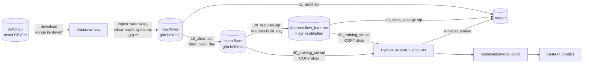
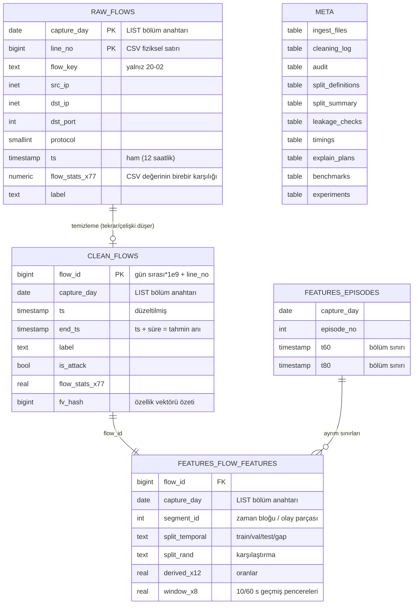

# SQL Tabanlı Ağ Saldırısı Tespit Sistemi

CSE-CIC-IDS2018 veri setindeki **16,2 milyon etiketli ağ akışını** PostgreSQL'e yükleyen,
denetleyip temizleyen, model özelliklerinin önemli bölümünü **SQL ile** üreten ve normal/saldırı
trafiğini ayıran bir sistem. Veri hattı, deney tasarımı ve sonuçlar yeniden üretilebilir;
README'deki her sayı bu makinede gerçekten çalıştırılmış bir komuttan gelir
(`reports/` altındaki raporlar `meta` şemasından ve deney çıktılarından otomatik üretilir).

> **Kapsam uyarısı.** Buradaki metrikler, *etiketli ve kontrollü bir laboratuvar veri setinde*
> ölçülmüş saldırı tespitidir. Gerçek bir savunma ağında kanıtlanmış performans **değildir**:
> saldırılar bilinen araçlarla, bilinen saatlerde, tek bir test ağında üretilmiştir; normal trafik
> de bir profil üreticisinden gelir. Gerçek ağda trafik karışımı, protokoller, saldırgan davranışı ve
> etiket kalitesi farklıdır. Bu farkı ölçmeye en yakın deney aşağıdaki *gün dışarıda bırakma*
> testidir ve orada başarı belirgin biçimde düşer.

**Özet (tam veri, 15,8 M temiz akış):**

| Test | Model | PR-AUC | Recall | 1.000 normal akışta yanlış alarm |
|---|---|---|---|---|
| Kronolojik ayrım, her saldırının ileriki dakikaları | LightGBM | 0,990 | 0,941 | 1,65 |
| Aynı test, eğitimde birebir görülmemiş vektörler | LightGBM | 0,978 | 0,904 | 1,91 |
| Tek parametreli hız kuralı (karşılaştırma) | eşik | 0,765 | 0,686 | 5,70 |
| **Bütün bir günü (ve saldırı senaryosunu) dışarıda bırakma**, 10 günün medyanı | LightGBM | **0,53** | **0,25** | 0,21 |

İlk satır "bu saldırıyı başladıktan birkaç dakika sonra tanıyabiliyor mu" sorusunu, son satır
"hiç görmediği bir güne/senaryoya genelleyebiliyor mu" sorusunu cevaplar. İkisi arasındaki fark bu
projenin asıl bulgusudur.

---

## İçindekiler
1. [Veri seti](#veri-seti)
2. [Mimari ve şema](#mimari-ve-şema)
3. [Kurulum](#kurulum)
4. [Çalıştırma](#çalıştırma)
5. [Veri hattı: içe aktarma, denetim, temizleme](#veri-hattı-içe-aktarma-denetim-temizleme)
6. [SQL ile özellik üretimi](#sql-ile-özellik-üretimi)
7. [Deney yöntemi](#deney-yöntemi)
8. [Sonuçlar](#sonuçlar)
9. [Performans ölçümleri](#performans-ölçümleri)
10. [Tahmin API'si](#tahmin-apisi)
11. [Testler](#testler)
12. [Sınırlamalar](#sınırlamalar)
13. [Proje yapısı](#proje-yapısı)
14. [Kaynak ve atıf](#kaynak-ve-atıf)

---

## Veri seti

| | |
|---|---|
| Kaynak | Communications Security Establishment (CSE) & Canadian Institute for Cybersecurity (CIC), [unb.ca/cic/datasets/ids-2018](https://www.unb.ca/cic/datasets/ids-2018.html) |
| Dağıtım | AWS Open Data, `s3://cse-cic-ids2018` (ca-central-1), kimlik doğrulama gerekmez |
| Kullanılan kısım | `Processed Traffic Data for ML Algorithms/` — CICFlowMeter-V3 ile çıkarılmış, etiketli akış CSV'leri: 10 dosya, 6,89 GB |
| Kullanım koşulu | Yeniden dağıtım serbest; her kullanım veri setine atıf ve AWS sayfasına bağlantı içermelidir (bkz. [Kaynak ve atıf](#kaynak-ve-atıf)) |
| Sütunlar | 9 dosyada 80 sütun (`Dst Port, Protocol, Timestamp`, 76 akış istatistiği, `Label`); 20-02 dosyasında ek olarak `Flow ID, Src IP, Src Port, Dst IP` |

İndirme, dosya listesi ve boyutları S3 `ListObjectsV2` yanıtından doğrulanır; yarım kalan indirme
`Range` ile devam eder (`ids/download.py`). **Ham CSV'ler Git'e eklenmez.** Repoda yalnızca test ve
hızlı deneme için her dosyadan etiket-tabakalı küçük örnekler vardır (`data/sample/*.csv.gz`, toplam
38.128 satır, temizlik sonrası 38.082; 3,7 MB).

### Veride bulunan sorunlar (bu projede ölçüldü)

| Sorun | Kanıt | Karar |
|---|---|---|
| **Zaman damgaları 12 saatlik, AM/PM yok** | Ham saat histogramında yakalama 08:00'de başlıyor, 01–07 saatleri öğleden sonraya ait; 14-02 SSH saldırısı CSV'de 02:01–03:32, resmi takvimde 14:01–15:31 | saat < 8 ise +12 saat (8.122.897 satır). Düzeltme sonrası tüm saldırı aralıkları resmi takvimle örtüşüyor |
| **Dosyalar Excel satır sınırında kesilmiş** | 7 dosya tam 1.048.575 (± tekrar başlık) satır | Geri getirilemez; sınırlama olarak raporlanır. Ör. 16-02 dosyası 13:48:44'te biter, resmi takvimde 13:45–14:19 süren DoS-Hulk'un yalnızca ilk ~3 dakikası var; 21-02 satırlarının ~%99'u 14:xx saatinde |
| Dosya içinde tekrar eden başlık satırları | 16-02: 1, 28-02: 33, 01-03: 25 | İçe aktarmada ayıklanır ve sayılır |
| Gün dışı zaman damgaları (1970-01-xx) | 14 satır | Düşürülür |
| Birebir tekrar eden kayıtlar | 410.707 satır (ör. FTP-BruteForce 193.360 → 39.352) | İlki tutulur |
| Etiket çelişkisi (aynı akış + aynı zaman, farklı etiket) | 13.212 satır | Grup tamamen düşürülür |
| `Infinity` / `NaN` oranlar | `Flow Pkts/s` 95.760 Inf; `Flow Byts/s` 59.721 NaN + 36.039 Inf — hepsi `Flow Duration = 0` akışlar | NULL; eksik değer doldurma yalnızca eğitimde öğrenilir |
| Negatif IAT | 2 hücre | NULL |
| `Init Fwd/Bwd Win Byts = -1` | 4,4 M / 8,3 M hücre | CICFlowMeter'ın "gözlenmedi" işareti; **korunur** |
| Tutarlılık denetimleri | `TotLen = Pkts × Mean`, `Subflow = Tot`, `Max ≥ Min`, `Flow Pkts/s = paket/süre` | 0 ihlal |
| Resmi takvimde olup veride olmayan | 20-02 `DDoS-LOIC-UDP` (13:13–13:32) bu dosyada hiç yok | Sınırlama olarak raporlanır |

Ayrıntılı tablolar: [`reports/data_audit.md`](reports/data_audit.md).

---

## Mimari ve şema



Tüm dönüşümler `sql/` altındaki dosyalardadır; Python yalnızca SQL'i çalıştırır, sonucunu okur ve
modelleri eğitir. Eğitim verisi `sql/40_training_set.sql` sorgusunun çıktısıdır — Python tarafında
hiçbir özellik yeniden hesaplanmaz.



**Bölümlendirme stratejisi.** Üç ana tablo da yakalama gününe göre `LIST` bölümlüdür. Her gün ayrı bir
CSV ve ayrı saldırı senaryosudur; bu yüzden gün hem yeniden yükleme birimi (bir gün, işlem içinde
yeniden oluşturulan bölümle idempotent yüklenir) hem de pencere hesaplarının doğal sınırıdır. Tek günlük
sorgular yalnızca ilgili bölümü tarar (ölçüm: [Performans](#performans-ölçümleri)).

**Ham katman `numeric`.** `raw` sütunları CSV'deki ondalık değeri birebir saklamak için `numeric`tir;
CICFlowMeter sütunlarının çoğu 0 veya kısa sayı olduğundan bu `double precision`'dan da küçüktür.
Model katmanı (`clean`) `real` (float32) kullanır.

---

## Kurulum

Gereksinimler: Docker (Compose v2), Python 3.10+, ~1 GB boş RAM (örnek veri) / aşağıdaki tam veri
gereksinimleri.

```bash
docker compose up -d
```

```bash
python -m venv .venv
```

```bash
.venv/bin/pip install -r requirements.lock
```

(Windows: `.venv\Scripts\pip install -r requirements.lock`.) `requirements.lock` birebir sürüm kilitli
bağımlılık listesidir. PostgreSQL 16 konteyneri `localhost:5434`'te açılır (`IDS_PG_PORT` ile değişir);
bağlantı ayarları `IDS_PG_*` ortam değişkenleriyle, veritabanı adı `IDS_DB` ile seçilir.

### Tam veri için gereken kaynaklar (ölçülen)

| Kaynak | Ölçülen | Not |
|---|---|---|
| İndirme | 6,89 GB CSV | `--delete-csv` ile her dosya yüklenip satır sayısı doğrulanınca silinir |
| PostgreSQL | 16 GB (raw 7,7 · clean 5,9 · features 2,8) | Docker VM diskinde |
| Parquet (isteğe bağlı) | > 1,9 GB (tamamı bu makinede disk dolduğu için ölçülemedi) | `export` komutu; eğitim Parquet yoksa SQL'den doğrudan okur |
| RAM (eğitim) | Python ~10 GB (bu çalıştırmada bellek taahhüdü artışı) | Eğitim bölümündeki normal trafik %35'e seyreltilir (aşağıda) |

Önerilen: ≥ 35 GB boş disk (CSV'ler silinmezse ≥ 42 GB), ≥ 24 GB RAM.

---

## Çalıştırma

### Küçük örnek veriyle (repodaki `data/sample`, bu makinede 102 s)

```bash
bash scripts/run_sample.sh
```

(Windows PowerShell: `scripts\run_sample.ps1`.) Bu betik `ids_sample` veritabanında tüm hattı
çalıştırır ve raporları `reports/ids_sample/` altına yazar. Örnek, her saldırı etiketinden en fazla
600 satır içerecek şekilde **bilerek dengelenmiştir**; oradaki metrikler tam veri sonucu yerine geçmez.

### Tam veriyle

```bash
bash scripts/run_full.sh
```

Adım adım (her komut ayrı çalıştırılabilir ve tekrar çalıştırılabilir):

| Komut | Ne yapar |
|---|---|
| `python -m ids download` | 10 CSV'yi S3'ten indirir, boyutları doğrular |
| `python -m ids make-sample` | Tam CSV'lerden `data/sample` örneklerini üretir |
| `python -m ids ingest [--delete-csv]` | CSV → `raw.flows` (akış hâlinde COPY) |
| `python -m ids clean` | `11_audit.sql` + `10_clean.sql` → `clean.flows`, `meta.cleaning_log` |
| `python -m ids features` | `20_features.sql` + `30_splits_leakage.sql` |
| `python -m ids export` | (isteğe bağlı) `40_training_set.sql` → Parquet |
| `python -m ids train --experiment all` | ana deney, ablasyon, çok sınıflı, gün dışarıda bırakma, rastgele ayrım karşılaştırması |
| `python -m ids bench` | performans karşılaştırmaları, `EXPLAIN ANALYZE`, API gecikmesi |
| `python -m ids report` | `meta` + deney çıktılarından `reports/*.md` |
| `python -m ids serve` | FastAPI servisi (`127.0.0.1:8000`) |

---

## Veri hattı: içe aktarma, denetim, temizleme

**İçe aktarma** (`ids/ingest.py`). Dosya hiçbir zaman tamamen belleğe alınmaz: satırlar okunur, tekrar
eden başlık ve sütun sayısı tutmayan satırlar ayıklanıp sayılır, her satıra `capture_day` ve fiziksel
satır numarası eklenir ve ~16 MB'lık bloklar `COPY FROM STDIN` ile yazılır. Gün bölümü **aynı işlem
içinde** yeniden oluşturulur; `wal_level=minimal` ile bu COPY WAL üretmez ve komut idempotenttir.
Yükleme sonrası "yüklenen + tekrar başlık + bozuk + boş = dosyadaki satır" denklemi doğrulanır;
tutmazsa hata verir (ve `--delete-csv` dosyayı silmez).

**Denetim** (`sql/11_audit.sql`) ham veride gün × etiket dağılımını, saat histogramını, gün dışı
zaman damgalarını, her sütun için negatif/sonsuz/NaN/boş sayılarını (tek taramada) ve tutarlılık
kurallarını `meta.audit`'e yazar.

**Temizleme** (`sql/10_clean.sql`, `clean.build_day(gün)`) kuralları sırayla uygular ve her kuralın
etkilediği satır sayısını `meta.cleaning_log`'a yazar:

| Adım | Kural | İşlem | Satır / hücre |
|---|---|---|---|
| 0 | ham satır (`raw.flows`) | girdi | 16.232.943 |
| 1 | zaman damgası boş / yakalama günü dışında | düşür | 14 |
| 2 | 12 saatlik saat düzeltmesi (saat < 8 → +12 saat) | düzelt | 8.122.897 |
| 3 | zorunlu alan eksik | düşür | 0 |
| 4 | negatif `flow_duration` | düşür | 0 |
| 5 | Infinity / NaN / negatif ölçüm → NULL | düzelt (hücre) | 191.522 |
| 6 | birebir tekrar eden kayıt | düşür | 410.707 |
| 7 | etiket çelişkisi (aynı akış, farklı etiket) | düşür | 13.212 |
| 9 | temiz satır (`clean.flows`) | çıktı | **15.809.010** |

16.232.943 − 14 − 410.707 − 13.212 = 15.809.010: denklem kapanır.

Tekrar ve çelişki tespiti bütün satırları sıralamak yerine yalnızca `(line_no, md5)` anahtar
tablosunda yapılır; bu, 7,9 M satırlık günde bile geçici disk kullanımını küçük tutar.

---

## SQL ile özellik üretimi

`sql/20_features.sql` her gün için tek bir `INSERT … SELECT` ile iki grup özellik üretir.

**Satır düzeyi (12):** `duration_s`, paket başına ileri/geri bayt, geri/ileri bayt ve paket oranları,
ileri yöndeki yük payı (`payload / (payload + header)`), `ln(1 + toplam bayt)`, IAT değişim katsayısı,
aktif/boşta oranı, yanıtsız akış, sıfır süreli akış, iyi bilinen port.

**Zaman penceresi (8), yalnızca tahmin anında bilinenlerden.** CICFlowMeter bir akışın kaydını ancak
akış kapandığında üretir; bu yüzden tahmin anı akışın **bitiş** anıdır (`end_ts = ts + süre`).
Pencereler `ORDER BY end_ts RANGE BETWEEN '60 seconds' PRECEDING AND CURRENT ROW` ile yalnızca o ana
kadar **bitmiş** akışları görür ve akışın kendisi toplamlardan çıkarılır:
aynı hedef porta son 10/60 s'de biten akış sayısı, tüm portlar için 60 s sayısı, portun paya oranı,
porttaki akışların ortalama ileri paket sayısı ve süresi, yanıtsız akış ve RST payı. Etiket hiçbir
pencerede kullanılmaz. Test `test_window_features_only_see_past`, *önce başlayıp sonra biten* bir akışın
pencerede görünmediğini elle hesaplanmış değerlerle doğrular.

Bir uygulama ayrıntısı: PostgreSQL'de `float` toplamlarının kayan pencere için ters geçiş fonksiyonu
yoktur, bu yüzden her satırda çerçeve baştan toplanır (yoğun DoS anında karesel maliyet). Toplamlar
tamsayıya çevrilerek O(1) güncellenir (ölçüm: [Performans](#performans-ölçümleri)).

**Modele girmeyen alanlar** (`ids/columns.py:FORBIDDEN_FEATURES`, testle denetlenir): etiket,
zaman damgası, gün, dosya adı, satır numarası, IP'ler, kaynak port, akış kimliği, ayrım etiketleri.
Eğitim bölümünde sabit olan 8 sütun (`bwd_psh_flags`, `bwd_urg_flags` ve 6 "bulk" sütunu) otomatik
elenir; model 90 özellik kullanır. `dst_port` ve `init_*_win_byts` canlıda elde edilebilir ama bu test
ağına özgü kısayol riski taşır; ablasyonla etkileri ölçülmüştür.

---

## Deney yöntemi

### Ayrım: model eğitiminden önce SQL'de sabitlenir

Saldırı türleri yalnızca belirli günlerde ve belirli saatlerde vardır (ör. SQL Injection sadece
22-02 ve 23-02 öğleden sonra). Bu yüzden iki tasarım birlikte kullanılır:

1. **Ana test — olay farkındalıklı kronolojik ayrım (`split_temporal`).** Her gün, saldırı akışları
   zamana göre sıralanır; aralarında 5 dakikadan uzun boşluk olan kümeler ayrı *patlama*dır (bulunan 26
   patlama resmi takvimdeki oturumlarla örtüşür). Her patlama, kendi saldırı akışlarının zamansal
   %60 ve %80 yüzdeliklerinden bölünür: öncesi **train**, arası **val**, sonrası **test**. Böylece her
   saldırı türü üç bölümde de bulunur ve **her patlamanın içinde test, train'den sonraki zamandır**. Patlama içindeki
   normal akışlar aynı zaman sınırlarını izler. Sınırlardan sonra `min(60 s, patlamanın %5'i)` ve
   patlamaların 60 s öncesi/sonrası **gap** olarak dışarıda bırakılır. Saldırısız zaman 10 dakikalık
   bloklara bölünüp `train,train,val,train,test` döngüsüyle atanır (bölüm değişen blok başı 60 s gap).
   *Bu ölçüm "aynı saldırının ileriki dakikalarını yakalayabiliyor mu" sorusunu cevaplar; görülmemiş
   saldırı türüne genellemeyi ölçmez.*
2. **Zorlayıcı test — gün dışarıda bırakma (leave-one-day-out).** Her gün için model yalnızca diğer
   günlerin train/val bölümleriyle eğitilir, eşik diğer günlerin val bölümünde seçilir ve dışarıda
   bırakılan günün **tüm** akışlarında test edilir.
3. **Karşılaştırma — rastgele satır ayrımı (`split_rand`)**, aynı model ve aynı eğitim boyutuyla.

İlk ayrım sürümü etiketlerin `[ilk, son]` zaman aralığını %60/%20/%20 bölüyordu; saldırı bittikten
sonra görülen birkaç dağınık akış aralığı uzattığı için DDoS-LOIC-HTTP'nin 575 bininin train'e,
yalnızca 797'sinin test'e düştüğü görüldü ve yüzdelik tabanlı sürüme geçildi.

| Ayrım | train | val | test | gap |
|---|---|---|---|---|
| zamansal (satır / saldırı) | 8.946.278 / 1.407.148 | 2.828.534 / 406.400 | 2.804.561 / 409.306 | 1.229.637 / 124.806 |
| rastgele (satır / saldırı) | 9.488.585 / 1.409.480 | 3.160.696 / 468.356 | 3.159.729 / 469.824 | — |

On beş etiketin her biri zamansal ayrımın üç bölümünde de bulunur (en küçüğü: SQL Injection
50 / 13 / 13). Etiket bazında tam dağılım: [`reports/splits.md`](reports/splits.md).

### Sızıntı denetimleri (`sql/30_splits_leakage.sql`, `meta.leakage_checks`)

| Denetim | Sonuç |
|---|---|
| `flow_id` tekilliği (15,8 M) | 0 tekrar |
| Bölüm saflığı: her zaman bloğu / patlama parçası tek bir bölümde | 468 segment, 0 ihlal |
| Test kimliklerinin train'de bulunması (e2e testi) | 0 |
| Özellik vektörü train'de birebir var — zamansal val / test | %26,4 / %26,6 |
| Özellik vektörü train'de birebir var — rastgele val / test | %26,4 / %26,4 |
| Farklı bölümdeki ardışık bloklar arası boşluk (zamansal) | medyan 61 s; 369 çiftin 16'sı < 60 s, en kötüsü −420 s (üst üste) |

Son satır dürüstçe okunmalıdır: **saldırı patlamalarının içinde** test her zaman train'den sonradır,
ama saldırısız zaman blokları döngüsel atandığı için gün içinde bir test bloğundan sonra yine bir
train bloğu gelebilir; ayrıca bir 10 dakikalık normal-trafik bloğu, kendi içinde bir patlamayı
kapsayabilir (negatif boşluk buradan gelir). Yani normal trafik için train, testten *sonraki*
dakikalardan da örnek içerir. Saldırı akışlarının kronolojisi bundan etkilenmez.

Önemli bulgu: zamansal ayrımda bile test akışlarının **%26,6'sının tüm akış ölçümleri eğitimdeki bir
akışla birebir aynı** (aynı kaba kuvvet isteği ya da aynı DNS sorgusu binlerce kez). Bu kaçınılmazdır ve
sonuçları şişirebilir; bu yüzden tüm test sonuçları ayrıca **eğitimde görülmemiş vektörler** alt
kümesinde de raporlanır.

### Öğrenme ve seçim kuralları

- Eksik değer doldurma, `sign·log1p` dönüşümü ve ölçekleme sklearn `Pipeline` içinde **yalnızca
  train'de** öğrenilir; sabit sütun eleme de train'e göre yapılır (`tests/test_unit.py` denetler).
- **Sınıf dengesizliği:** yükleme sırasında yalnızca **train bölümündeki normal akışlar**
  `hash(flow_id)` ile deterministik olarak %35'e seyreltilir (4,05 M train satırı, %34,8 saldırı);
  saldırıların tamamı ve val/test'in tamamı korunur. Modeller ayrıca `class_weight="balanced"`
  kullanır. Eşik ve tüm metrikler gerçek sınıf dağılımındaki val/test üzerinde hesaplanır.
- **Eşik doğrulamada seçilir:** (a) val F1'ini en büyükleyen eşik, (b) val'de 1.000 normal akışta en
  fazla 0,1 / 1 / 10 yanlış alarm veren en düşük eşik. En iyi model val PR-AUC'una göre seçilir.
  Test bölümü hiçbir seçimde kullanılmaz.
- Başarı ölçütleri: karışıklık matrisi, saldırı sınıfı için precision/recall/F1, PR-AUC ve
  **1.000 normal akış başına yanlış alarm (YA/1000)**. Accuracy yalnızca bilgi için verilir (hep
  "normal" diyen model %85 accuracy alır).
- Tohum `20180214`, bağımlılıklar `requirements.lock` ile kilitli.

Yöntemler: çoğunluk sınıfı; tek parametreli **hız kuralı** (aynı porta son 60 s'de biten akış sayısı ≥
eşik); lojistik regresyon (train'den 2 M satır); LightGBM (erken durdurma val PR-AUC).

---

## Sonuçlar

Tüm sayılar test bölümündendir; eşikler doğrulamada seçilmiştir. Kaynak:
[`reports/results.md`](reports/results.md) ve `reports/results/*_ids.json`.

### 1. Ana deney: kronolojik ayrım (test: 2.804.561 akış, %14,6 saldırı)

Eşik = doğrulamada F1'i en büyükleyen eşik.

| Yöntem | PR-AUC | Precision | Recall | F1 | YA/1000 | Görülmemiş vektörlerde PR-AUC |
|---|---|---|---|---|---|---|
| Çoğunluk sınıfı (hep "normal") | 0,146 | — | 0 | 0 | 0 | — |
| Hız kuralı: porta son 60 s'de biten akış ≥ 9.357 | 0,765 | 0,954 | 0,686 | 0,798 | 5,70 | 0,667 |
| Lojistik regresyon | 0,954 | 0,964 | 0,919 | 0,941 | 5,81 | 0,914 |
| **LightGBM** | **0,990** | **0,990** | **0,941** | **0,965** | **1,65** | **0,978** |

Hep "normal" diyen model **%85,4 accuracy** alır; LightGBM'in accuracy'si %99,0'dır. Bu yüzden accuracy
başarı ölçütü olarak kullanılmadı. "Görülmemiş vektörler": test akışlarının, tüm ölçümleri eğitimdeki
hiçbir akışla birebir aynı olmayan %73,4'lük alt kümesi.

**Yanlış alarm bütçesi doğrulamadan teste taşınmıyor.** LightGBM için doğrulamada "1.000 normal akışta
≤ 1 yanlış alarm" veren eşik testte **2,29** yanlış alarm verdi (recall 0,944); "≤ 0,1" eşiği testte
0,61 verdi (recall 0,930). Eşik zamanla kayıyor; canlıda eşik izlenmeli ve yeniden ayarlanmalıdır.

**Saldırı türüne göre yakalama oranı** (LightGBM, aynı eşik):

| Tür | Test akışı | Yakalanan |
|---|---|---|
| DoS-Hulk, SlowHTTPTest, GoldenEye; FTP-, SSH-BruteForce; DDoS-LOIC-UDP | 67.624 / 3.469 / 6.027 / 7.471 / 22.171 / 330 | %100 |
| DDoS-HOIC / DDoS-LOIC-HTTP | 110.733 / 105.983 | %99,95 / %99,98 |
| DoS-Slowloris | 1.858 | %94,3 |
| Bot | 55.932 | %93,7 |
| Brute Force-XSS / Brute Force-Web | 41 / 111 | %51 / %40 |
| **Infiltration** | 27.543 | **%25,9** |
| SQL Injection | 13 | 2 / 13 |

Hacim ve hız izi bırakan saldırılar neredeyse tamamen yakalanıyor; HTTP içeriği düzeyindeki saldırılar
(web kaba kuvvet, XSS, SQL Injection) ve Infiltration akış istatistiklerinde normal trafikten zor
ayrılıyor. Web saldırılarının test örneği çok küçük olduğundan bu oranların belirsizliği yüksektir.

### 2. Zorlayıcı test: gün dışarıda bırakma

Her satırda model o gün hiç görülmeden eğitildi; eşik diğer günlerin doğrulama bölümünde seçildi.

| Dışarıda bırakılan gün | Saldırı türleri | Tür başka günde var mı | Test akışı | Saldırı payı | PR-AUC | Precision | Recall | YA/1000 |
|---|---|---|---|---|---|---|---|---|
| 14-02 | FTP-, SSH-BruteForce | hayır | 822.942 | %19,0 | 0,704 | 0,999 | 0,302 | 0,10 |
| 15-02 | DoS-GoldenEye, Slowloris | hayır | 1.046.154 | %4,9 | 0,366 | 0,966 | 0,207 | 0,38 |
| 16-02 | DoS-Hulk, SlowHTTPTest | hayır | 900.988 | %50,4 | 1,000 | 1,000 | 0,979 | 0,00 |
| 20-02 | DDoS-LOIC-HTTP | hayır | 7.948.746 | %7,2 | 0,902 | 0,834 | 0,500 | 7,78 |
| 21-02 | DDoS-HOIC, LOIC-UDP | hayır | 1.031.018 | %65,0 | 1,000 | 1,000 | 0,594 | 0,00 |
| 22-02 | Web BF, XSS, SQL Injection | evet (23-02) | 1.045.288 | %0,03 | 0,344 | 0,897 | 0,265 | 0,01 |
| 23-02 | Web BF, XSS, SQL Injection | evet (22-02) | 1.045.961 | %0,05 | 0,309 | 0,945 | 0,242 | 0,01 |
| 28-02 | Infiltration | evet (01-03) | 593.780 | %10,5 | **0,096** | 0,103 | 0,081 | **81,7** |
| 01-03 | Infiltration | evet (28-02) | 331.017 | %28,1 | 0,358 | 0,756 | 0,003 | 0,32 |
| 02-03 | Bot | hayır | 1.043.116 | %27,1 | 0,701 | 0,775 | 0,009 | 0,95 |
| **medyan** | | | | | **0,533** | | **0,254** | **0,21** |

Okuma:
- **Genelleme türe değil, iz bırakmaya bağlı.** DoS-Hulk/SlowHTTPTest eğitimde hiç yokken %98 yakalandı
  (diğer günlerdeki DoS/DDoS örüntüsünden genelledi). Web saldırıları ve Infiltration başka günde
  eğitimde vardı ama yine zayıf kaldı.
- **21-02: sıralama kusursuz, eşik yanlış.** PR-AUC 1,000 ama recall 0,594; diğer günlerde seçilen eşik
  bu gün için fazla yüksek. Daha zayıf biçimde 02-03 (Bot: PR-AUC 0,70, recall 0,009) için de geçerli.
- **28-02'de model rastgeleden kötü.** PR-AUC (0,096) günün saldırı payının (%10,5) altında ve 1.000
  normal akışta 81,7 yanlış alarm veriyor. Bu veri setinde "Infiltration" etiketli akışların büyük kısmı
  ele geçirilmiş makinenin sıradan görünen trafiğidir; akış istatistikleriyle ayrılamaması bilinen bir
  sorundur.

### 3. Rastgele satır ayrımı ile karşılaştırma

Aynı model, aynı eğitim boyutu (3 M satır):

| Ayrım | PR-AUC | Precision | Recall | F1 | YA/1000 | Görülmemiş vektörlerde PR-AUC |
|---|---|---|---|---|---|---|
| Zamansal | 0,990 | 0,990 | 0,942 | 0,965 | 1,65 | 0,978 |
| Rastgele | 0,997 | 0,984 | 0,959 | 0,972 | 2,68 | 0,994 |

Rastgele ayrım, aynı saldırı oturumunun komşu akışlarını train ve test'e dağıttığı için daha iyimser
sonuç verir (kaçırılan saldırı oranı 0,058'den 0,041'e iner). Fark bu veri setinde küçüktür; asıl
iyimserlik kaynağı ayrım yöntemi değil, test saldırılarının eğitimdekiyle aynı senaryodan gelmesidir
(gün dışarıda bırakma testiyle kıyaslayın).

### 4. Ablasyon (LightGBM, 3 M eğitim satırı)

| Özellik kümesi | Özellik | PR-AUC | Recall | YA/1000 | Görülmemiş vektörlerde PR-AUC |
|---|---|---|---|---|---|
| Tümü | 90 | 0,990 | 0,942 | 1,77 | 0,978 |
| Kısayol riskli alanlar çıkarıldı (`dst_port`, `init_*_win_byts`) | 87 | 0,990 | 0,940 | 1,47 | 0,977 |
| SQL pencere özellikleri çıkarıldı | 82 | 0,972 | 0,927 | 0,87 | 0,949 |
| Yalnızca CICFlowMeter (SQL özelliği yok) | 70 | 0,973 | 0,926 | 0,63 | 0,950 |

SQL'de üretilen zaman penceresi özellikleri PR-AUC'u 0,973'ten 0,990'a çıkarıyor (görülmemiş
vektörlerde 0,950 → 0,978); satır düzeyi türetilmiş özelliklerin ek katkısı ölçülebilir değil. Bedeli:
aynı eşik yönteminde yanlış alarm 0,63'ten 1,77'ye çıkıyor. Hedef portu ve TCP pencere boyutunu
çıkarmak sonucu değiştirmiyor; model bu test ağına özgü port/pencere değerlerine yaslanmıyor.

### 5. Saldırı türü tahmini (ayrı deney, 15 sınıf)

LightGBM, 1,5 M eğitim satırı, test 2,8 M akış: **macro-F1 0,841**, ağırlıklı F1 0,962.

| Sınıf | Precision | Recall | F1 |
|---|---|---|---|
| DDoS-HOIC, DDoS-LOIC-HTTP, DoS-Hulk, DoS-GoldenEye, SlowHTTPTest, SSH-BruteForce | 1,000 | 1,000 | 1,000 |
| DDoS-LOIC-UDP / FTP-BruteForce / Slowloris / Bot | 1,00 / 1,00 / 1,00 / 1,00 | 0,94 / 0,94 / 0,92 / 0,92 | 0,97 / 0,97 / 0,96 / 0,96 |
| Normal | 0,998 | 0,936 | 0,966 |
| Brute Force-XSS / Brute Force-Web / SQL Injection | 0,67 / 0,27 / 0,50 | 0,88 / 0,92 / 0,31 | 0,76 / 0,41 / 0,38 |
| **Infiltration** | **0,140** | 0,921 | **0,243** |

Sınıf ağırlıklandırması Infiltration recall'ünü yükseltiyor ama bunu çok sayıda normal akışı
Infiltration diye işaretleyerek yapıyor (precision 0,14): ikili modeldeki zorluğun aynısı.

### Süreler (bu makine)

İçe aktarma 1.249 s, denetim + temizleme 1.330 s, özellik + ayrım 487 s (indirme hariç). Ana deneyde
LightGBM eğitimi 133 s (4,05 M satır), lojistik regresyon 183 s (2 M satır). Model düzeyinde tek akış
tahmini p50 0,076 ms, toplu tahmin ~260 bin akış/s.

---

## Performans ölçümleri

Tümü `python -m ids bench` ile tam veride ölçüldü ve `meta.benchmarks`'a yazıldı; karşılaştırma günü
21-02 (1,05 M ham satır). Ayrıntı: [`reports/performance.md`](reports/performance.md), planlar:
[`reports/explain/`](reports/explain/).

| Karşılaştırma | Seçilmeyen | Kullanılan | Fark |
|---|---|---|---|
| Kayan 60 s pencere toplamı (1,03 M satır) | `sum(real)`: **600 s'de bitmedi** | `sum(bigint)`: **1,31 s** | > 450× |
| Ham veri denetimi (bir gün) | sütun başına ayrı tarama: 55,5 s | tek tarama: 3,3 s | 16,7× |
| Bölüm budama (bir günün sorgusu) | `ts::date = gün`: 0,92 s, 10 bölüm taranır | `capture_day = gün`: 0,073 s, 1 bölüm | 12,6× |
| 100 bin satır yükleme, hız | `executemany INSERT`: 12.789 satır/s | `COPY`: 78.970 satır/s | 6,2× |
| 100 bin satır yükleme, WAL | `COPY` mevcut tabloya: 42,3 MB | `COPY` aynı işlemde oluşturulan bölüme: 0,12 MB | 365× az WAL |
| Ham katman sayı tipi (77 ölçüm sütunu) | `double precision`: 632 B/satır | `numeric`: 357 B/satır | %43 küçük |
| Port penceresi, en küçük gün (331 bin satır) | indeks yok: 0,41 s | `(dst_port, end_ts)` indeksi: 0,19 s (+0,94 s kurulum) | indeks kullanılmadı |

Notlar:
- Float toplamı PostgreSQL'de kayan pencere için ters geçiş fonksiyonuna sahip değildir; çerçeve her
  satırda baştan toplanır. 21-02'deki yoğun HOIC saldırısında aynı porta 60 s içinde on binlerce akış
  düştüğü için maliyet karesele döner. İki sorgu yalnızca toplam tipinde ayrışır
  (`sql/bench/window_*_sum.sql`).
- Aynı işlemde oluşturulan bölüme `COPY` satır hızında biraz yavaştır (79 bin vs 86 bin satır/s:
  commit'te dosya senkronizasyonu), ama WAL yazmaz. İçe aktarmada bu yol seçildi çünkü bölüm zaten
  işlem içinde yeniden oluşturuluyor (idempotent yükleme).
- İndeks tek seferlik özellik üretiminde kendi kurulum maliyetini çıkarmıyor (0,19 + 0,94 > 0,41 s);
  bu yüzden özellik hattı indeks kurmaz, pencere sorgusu sıralamayla çalışır.

**API gecikmesi** (localhost HTTP/1.1, keep-alive, tek istemci, test bölümünden 1.000 gerçek akış):
uçtan uca p50 **5,15 ms**, p95 5,76 ms, p99 6,14 ms; sunucu içinde özellik hesabı + model p50 1,30 ms.
Model düzeyinde tek satır p50 0,076 ms, toplu ~260 bin akış/s.

---

## Tahmin API'si

```bash
python -m ids serve
```

`POST /predict` bir akışın CICFlowMeter ölçümlerini (`flow`) ve sensörün o akışın bittiği an
itibarıyla son 10/60 s özetlerini (`window`) alır; saldırı olasılığı, kullanılan eşik ve kararı döner.
`GET /model` model kartını (özellikler, eşikler, seçim yöntemi, test özeti), `GET /health` durumu verir.

Test bölümündeki bir Bot akışı için gerçek yanıt (sayılar kısaltıldı; `inference_ms` ilk istekte
ısınma içerir, sürekli çalışmada p50 1,3 ms):

```json
{"attack_probability": 0.99936, "threshold": 0.75803, "decision": "ATTACK",
 "model": "lightgbm", "inference_ms": 11.18}
```

Aynı yoldan bir normal akış: `attack_probability` 0,000045, `decision` `BENIGN`.

Doğrulama (tümü `tests/test_api.py`'de): bilinmeyen alanlar reddedilir — `label`, `src_ip`,
`timestamp` gibi sızıntı alanları API'ye de giremez; sayaçlar negatif olamaz; protokol {0, 6, 17};
port 0–65535; `min ≤ max`; `w10 ≤ w60 ≤ tümü`; `w60_port_n > 0` iken pencere ortalamaları zorunlu;
oranlar [0, 1]. Satır düzeyi türetilmiş özellikler servis anında `ids/features_py.py`'de hesaplanır;
bunun SQL'deki tanımla aynı sonucu verdiği gerçek veride test edilir
(`test_sql_and_python_derived_features_match`, eğitim/servis kayması denetimi).

---

## Testler

```bash
.venv/bin/python -m pytest
```

| Dosya | Kapsam | DB |
|---|---|---|
| `test_unit.py` | şema ↔ sütun listesi, eğitim sorgusu sütun sırası, yasaklı alanlar, akış hâlinde okuma (tekrar başlık, bozuk satır), eşik seçimi, YA bütçesi, metrikler, seyreltme, ön işlemenin yalnız train'de öğrenilmesi | — |
| `test_pipeline_db.py` | sentetik uç durumlarla (1970, öğleden sonra saati, negatif süre, Infinity, tekrar, etiket çelişkisi, tekrar başlık, bozuk satır) her temizleme kuralının sayımı; pencere özelliklerinin yalnızca geçmişi gördüğü (elle ve kaba kuvvetle); ayrım saflığı ve kronoloji | ✓ |
| `test_sample_e2e.py` | `data/sample` ile ingest → clean → features → export → train → API; SQL↔Python özellik eşliği; train/test kimlik kesişimi yok | ✓ |
| `test_api.py` | 13 geçersiz girdi durumu, boş oran kabulü, karar = eşik tutarlılığı | — |

DB testleri ayrı veritabanları (`ids_test`, `ids_test_sample`) kullanır ve PostgreSQL yoksa atlanır.
Tam veri testi normal test komutunun parçası değildir.

Son çalıştırma (bu makine, PostgreSQL açık): **37 test geçti, 0 atlandı, 0 başarısız**, 23,7 s
(`test_api` 16, `test_unit` 11, `test_pipeline_db` 6, `test_sample_e2e` 4).

---

## Sınırlamalar

- **Laboratuvar verisi.** Saldırılar bilinen araçlarla, bilinen saatlerde tek bir test ağında üretildi;
  normal trafik bir profil üreticisinden geliyor. Buradaki metrikler gerçek bir savunma ağındaki
  performansı göstermez. Buna en yakın ölçü gün dışarıda bırakma testidir (medyan recall 0,25).
- **Kesilmiş dosyalar.** 7 CSV, Excel'in 1.048.575 satır sınırında kesilmiş; bazı saldırıların yalnızca
  ilk dakikaları var (ör. 16-02 DoS-Hulk ~3 dakika). 20-02'deki DDoS-LOIC-UDP oturumu veride hiç yok.
- **Zaman damgası düzeltmesi bir çıkarımdır.** AM/PM bilgisi yok; "saat < 8 → +12" kuralı saat
  histogramına ve resmi saldırı takvimiyle örtüşmeye dayanıyor.
- **Etiket kalitesi.** Etiketler saldırgan IP ve zaman aralığına göre atanmış; özellikle Infiltration
  etiketli akışların çoğu saldırı gibi görünmüyor. Bazı etiketler hatalı olabilir.
- **Tekrar eden vektörler.** Test akışlarının %26,6'sı eğitimde birebir var; sonuçlar bu yüzden ayrıca
  görülmemiş vektörlerde de verildi, ama yakın-tekrarlar hâlâ iyimserlik katabilir.
- **Normal trafikte zamansal ayrım tam değil.** Saldırısız bloklar döngüsel atandığı için train, bazı
  test bloklarından sonraki normal trafiği de içeriyor (bkz. sızıntı tablosu).
- **Eşik taşınabilirliği.** Doğrulamada seçilen yanlış alarm bütçesi teste birebir taşınmıyor
  (1/1000 → 2,29/1000) ve günler arasında hiç taşınmıyor (21-02). Canlıda eşik izlenmeli.
- **Seyreltme.** Bellek sınırı yüzünden eğitim bölümündeki normal akışların %35'i kullanıldı; val/test
  ve saldırılar tam. Tüm normal trafikle eğitim sonuçları değiştirebilir.
- **Tek makine, tek çalıştırma.** Süreler bu makineye aittir; deneyler tek tohumla çalıştırıldı,
  güven aralığı verilmedi.
- **API girdisi.** Servis CICFlowMeter ölçümlerini ve 10/60 s pencere özetlerini hazır alır; paket
  yakalama ve canlı pencere hesabı bu projenin kapsamında değil.

---

## Proje yapısı

```
compose.yml              PostgreSQL 16 (toplu yükleme ayarlarıyla)
requirements.lock        kilitli bağımlılıklar
ids/                     Python paketi (python -m ids <komut>)
  download.py ingest.py  S3 indirme, akış hâlinde COPY
  pipeline.py            SQL aşamalarını çalıştırır, süreleri meta.timings'e yazar
  export.py              eğitim sorgusu -> Parquet ya da doğrudan bellek
  modeling.py train.py   modeller, eşikler, metrikler, deneyler
  api.py features_py.py  FastAPI servisi, satır düzeyi özelliklerin servis aynası
  bench.py report.py     performans karşılaştırmaları, Markdown raporları
sql/
  01_schema.sql          şemalar, bölümlü tablolar, meta tabloları
  10_clean.sql           temizleme kuralları, clean.build_day
  11_audit.sql           ham veri denetimi
  20_features.sql        ayrım tanımları, patlamalar, özellikler, features.build_day
  30_splits_leakage.sql  ayrım özetleri, sızıntı denetimleri
  40_training_set.sql    modelin okuduğu tek sorgu
  bench/                 karşılaştırma sorguları
data/sample/             etiket-tabakalı küçük örnekler (repoda)
reports/                 otomatik raporlar, EXPLAIN çıktıları, deney JSON'ları
tests/                   pytest
scripts/                 run_sample / run_full (sh + ps1)
```

---

## Kaynak ve atıf

Bu proje CSE-CIC-IDS2018 veri setini kullanır. Veri setinin lisansı gereği:

- Veri seti sayfası: <https://www.unb.ca/cic/datasets/ids-2018.html>
- AWS Open Data kaydı: <https://registry.opendata.aws/cse-cic-ids2018/>
- Iman Sharafaldin, Arash Habibi Lashkari, Ali A. Ghorbani, "Toward Generating a New Intrusion
  Detection Dataset and Intrusion Traffic Characterization", *4th International Conference on
  Information Systems Security and Privacy (ICISSP)*, Portekiz, Ocak 2018.

`data/sample/` altındaki dosyalar bu veri setinin küçük alt kümeleridir ve aynı atıf koşuluna tabidir.
